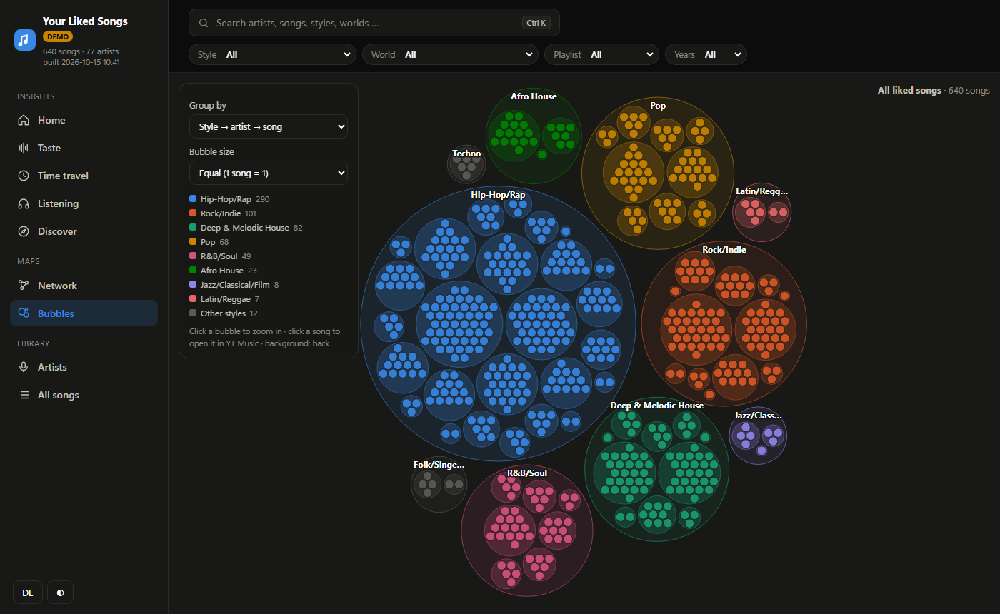

# YT Music Liked Songs – Export & Auswertung

[English](README.md) · **Deutsch**

Exportiert deine „Mag ich“-Songs aus YouTube Music als JSON/CSV, reichert sie mit Erscheinungsjahr,
Stil, Herkunft und Künstler-Beziehungen an und zeigt alles auf einer interaktiven Seite:

- **Start** – deine Musik-DNA: Stil-Mix, Kennzahlen und automatisch erkannte Auffälligkeiten
  (Elektronik-Anteil, Vielfalt, Entdecker oder Fan, Underground-Anteil, Hörzeit, Dauerbrenner …)
- **Geschmack** – Stile, Top-Künstler, Musik-Welten (Cluster), Stil-Mix deiner Playlists, Tags,
  Mainstream oder Underground, Herkunft, Kollaborationen, Feature-Könige
- **Zeitreise** – Erscheinungsjahre, Geschmacksentwicklung, Stil × Jahrzehnt, wie frisch du hörst,
  neue Künstler über die Zeit, Songlängen
- **Hören** (mit Google Takeout) – Hör-Kalender, Wochenverlauf, Wochentag × Uhrzeit mit Detail je Zeitfenster,
  Stil nach Tageszeit, Sessions, On Repeat, Künstler des Monats, vergessene Lieblinge, „oft gehört, nie geliked“
- **Entdecken** – Empfehlungen aus deinem eigenen Netzwerk (verwandte Künstler, die dir noch fehlen),
  Brücken-Künstler zwischen deinen Welten, zweite Chance, Hidden Gems, Zufallsfund
- **Netzwerk-Map** und **Bubble-Map** – Künstler-Netzwerk mit automatisch erkannten Musik-Welten und
  zoombare Stil → Künstler → Song-Bubbles
- **Künstler** und **Alle Songs** – durchsuch- und sortierbare Tabellen, CSV-Export der aktuellen Auswahl

Alles ist verknüpft: Ein **globaler Filter** (Stil, Welt, Playlist, Jahre, Künstler, Land) wirkt auf jede Seite,
jeder Balken und jeder Name ist anklickbar, jeder Künstler hat ein **Profil** (Songs, Like-Verlauf, Wiedergaben,
Verbindungen, ähnliche Künstler) und **Strg+K** durchsucht alles. Die Seite gibt es auf **Deutsch und Englisch**.




*Die Screenshots zeigen die eingebauten Demo-Daten.*

**Datenschutz:** Alles läuft lokal, deine Daten werden nirgends hochgeladen. Die Skripte sprechen nur mit
YouTube Music (dein Konto), MusicBrainz und optional Last.fm (nur Künstlernamen). Die Seite selbst lädt D3 von
cdnjs und die Cover-Bilder von den Bildservern von YouTube.

Ohne Konto ausprobieren: `python ytm.py demo` (siehe Schnellstart)

---

## Voraussetzungen

- Python **3.10+** ([python.org](https://www.python.org/downloads/); unter Windows beim Installieren „Add python.exe to PATH“ anhaken)
- [Git](https://git-scm.com/downloads) (oder das Repo auf GitHub als ZIP herunterladen: **Code → Download ZIP**)
- Ein YouTube-Music-Konto mit Liked Songs
- Optional: ein kostenloser [Last.fm-API-Key](https://www.last.fm/api/account/create) (deutlich bessere Stile)
- Optional: ein [Google-Takeout](https://takeout.google.com)-Export (Wiedergaben und Hörzeiten)

## Schnellstart

**1. Einmalig einrichten**

Windows (PowerShell):
```powershell
git clone https://github.com/cheatoskar/ytmusic-analyse.git
cd ytmusic-analyse
python -m venv .venv
.venv\Scripts\python -m pip install -r requirements.txt
```

macOS/Linux:
```bash
git clone https://github.com/cheatoskar/ytmusic-analyse.git
cd ytmusic-analyse
python3 -m venv .venv
.venv/bin/python -m pip install -r requirements.txt
```

**2. Ohne Konto ausprobieren** – erzeugt erfundene Beispieldaten und öffnet die Seite im Browser:
```powershell
.venv\Scripts\python ytm.py demo
```

**3. Mit deinen eigenen Likes** – die Details zu jedem Schritt stehen unten unter [Schritt für Schritt](#schritt-für-schritt):
```powershell
copy browser.example.json browser.json   # dann deinen Cookie eintragen (Schritt 2)
copy .env.example .env                   # optional: Last.fm-Key eintragen (Schritt 4)
.venv\Scripts\python ytm.py fetch        # Liked Songs abrufen
.venv\Scripts\python ytm.py enrich       # Jahre, Stile, Herkunft, verwandte Künstler (dauert, jederzeit unterbrechbar)
.venv\Scripts\python ytm.py build        # Seite bauen
.venv\Scripts\python ytm.py open         # im Browser öffnen
```
Unter macOS/Linux `cp` statt `copy` und `.venv/bin/python` statt `.venv\Scripts\python`.

Die fertige Seite liegt danach in **`out/index.html`** – später einfach doppelklicken. Nicht `web/index.html` öffnen,
das ist nur die Vorlage ohne Daten. Nach neuen Likes reichen `fetch`, `enrich` und `build`; schon geladene
Künstler kommen aus dem Cache.

In den Befehlen unten steht `python` für `.venv\Scripts\python` (Windows) bzw. `.venv/bin/python`.

## Schritt für Schritt

### 1. Google Takeout jetzt anfordern (optional, dauert Stunden bis 1 Tag)

1. <https://takeout.google.com> öffnen → **Auswahl aufheben**
2. Nur **YouTube und YouTube Music** anhaken
3. **Mehrere Formate** → bei **Verlauf** auf **JSON** stellen (Standard HTML funktioniert nicht)
4. **Alle YouTube-Daten enthalten** → nur **Verlauf**, **Playlists** und **music (library and uploads)**
   (Videos weglassen, die können riesig sein)
5. Einmalig exportieren, als .zip

### 2. Bei YouTube Music anmelden (`browser.json` anlegen)

Die Datei enthält dein Login-Cookie. Sie bleibt auf deinem Rechner und steht in `.gitignore` –
**niemals teilen oder committen.**

1. Vorlage kopieren: `browser.example.json` → `browser.json`
2. <https://music.youtube.com> in Chrome/Edge/Firefox öffnen und eingeloggt sein
3. **F12** → Reiter **Netzwerk** → Seite neu laden
4. Eine Anfrage wie `browse?…`, `account_menu?…` oder `guide?…` (Methode POST) anklicken
5. Unter **Request Headers** Rechtsklick auf `cookie` → **Wert kopieren**
6. In `browser.json` `PASTE_YOUR_COOKIE_HERE` durch diesen Wert ersetzen – eine Zeile, zwischen den Anführungszeichen

Alternative: `ytmusicapi browser` ausführen (wird mit den Requirements installiert) und alle Request-Header einfügen.

Dich in diesem Browser nicht bei YouTube abmelden, sonst wird das Cookie ungültig.

### 3. Liked Songs abrufen

```bash
python ytm.py fetch
```

### 4. Last.fm-API-Key (optional, empfohlen)

Ohne Key kommen Stile nur von MusicBrainz, und viele Künstler bleiben „Unbekannt“.
Key anlegen unter <https://www.last.fm/api/account/create> (Name und Beschreibung frei wählbar,
Callback und Homepage leer lassen; der Key erscheint sofort und ist für private Nutzung kostenlos).
`.env.example` nach `.env` kopieren und eintragen:

```
LASTFM_API_KEY=dein_key
```

### 5. Anreichern

```bash
python ytm.py enrich
```

Die Dauer wächst mit der Zahl der Künstler und Alben: etwa 1 s pro Album und Künstler (YT Music),
0,25 s pro Künstler (Last.fm) und 1,1 s pro Künstler (MusicBrainz erlaubt eine Anfrage pro Sekunde).
Bei ~3 000 Künstlern 1–2 Stunden. Abbrechen mit Strg+C ist unproblematisch – der nächste Lauf
macht dort weiter. Tipp: die Dienste parallel in getrennten Terminals laufen lassen:

```bash
python ytm.py enrich --no-lastfm --no-mb
```
```bash
python ytm.py enrich --no-albums --no-artists --no-mb
```
```bash
python ytm.py enrich --no-albums --no-artists --no-lastfm
```

### 6. Takeout einlesen (sobald die ZIP da ist)

```bash
python ytm.py takeout "Pfad/zu/takeout-XXXX.zip"
```

Die ZIP wird direkt gelesen, entpacken ist nicht nötig.

### 7. Auswertung bauen und öffnen

```bash
python ytm.py build
python ytm.py open
```

| Datei in `out/` | Inhalt |
|---|---|
| `index.html` | die interaktive Seite (braucht einmal Internet für D3 von cdnjs) |
| `report.md` | alle Kennzahlen als Text |
| `songs.csv` | alle Songs mit Metadaten (öffnet direkt in Excel) |
| `kuenstler_netzwerk.gexf` | Künstler-Graph für [Gephi](https://gephi.org) |

Direktlinks: `out/index.html#home`, `#taste`, `#time`, `#listen`, `#discover`, `#network`, `#bubbles`, `#artists`,
`#songs` sowie `?lang=de` / `?lang=en`. Filter und geöffnete Profile stehen ebenfalls in der Adresse
(z. B. `#taste?g=Trance&y0=2010&y1=2019`) und lassen sich so als Lesezeichen speichern.

## Sprache

- **Seite:** Umschalter oben rechts; Standard ist die Browsersprache.
- **Kommandozeile und `report.md`:** Systemsprache, umstellbar mit `YTM_LANG=de` oder `YTM_LANG=en`.
- **Zeitzone** der Hör-Heatmap: Systemzeitzone, umstellbar z. B. mit `YTM_TZ=Europe/Berlin`.

## Grenzen

- **ytmusicapi ist inoffiziell.** Ändert YouTube intern etwas, kann der Abruf brechen
  (`pip install -U ytmusicapi` hilft meistens). Die Anmeldung per Cookie ist in ytmusicapi als
  „deprecated“ markiert, funktioniert aber mit Version 1.12.
- YouTube Music meldet teils mehr Liked Songs, als es liefert (gelöschte/gesperrte Titel), und führt
  manche Songs doppelt; Duplikate werden entfernt, die Lücke wird angezeigt.
- **Like-Datum** gibt es nur, wenn dein Takeout die Liked-Liste mit Zeitstempeln enthält (oft nicht).
  Sonst zeigt „Geschmacksentwicklung“ die Like-Reihenfolge.
- **Wiedergaben** reichen nur so weit zurück, wie dein YouTube-Verlauf gespeichert wird
  (automatisches Löschen). YT Music spielt manchmal eine andere Version (Video statt Audio) mit
  eigener ID ab; „nie gespielt“ ist daher eine Obergrenze.
- **Stile** gehören zum Hauptkünstler, nicht zum einzelnen Song.
- Bei **Uploads** (von Nutzern hochgeladene Videos) wird der Künstler aus „Künstler - Titel“ gelesen,
  sonst steht der Kanalname.
- BPM/Energie/Tanzbarkeit gibt es nicht (Spotify hat diese Schnittstelle für neue Apps geschlossen).

## Aufbau

```
ytm.py             Kommandozeile (fetch, enrich, takeout, build, open, demo)
ytmlib/fetch.py    Abruf über ytmusicapi
ytmlib/enrich.py   Alben, Künstler, Last.fm, MusicBrainz (Cache in data/cache/)
ytmlib/takeout.py  Google-Takeout-Parser
ytmlib/build.py    Kennzahlen, Netzwerk + Louvain-Cluster, Ausgabe
ytmlib/genres.py   Tags → Stile
ytmlib/demo.py     erfundene Demo-Daten
web/               Oberfläche (D3, DE/EN), wird nach out/ kopiert:
                   core.js (Daten, Filter, Adresse), charts.js (Diagramme), pages.js (Seiten),
                   maps.js (Netzwerk, Bubbles), app.js (Navigation, Profil, Suche), i18n.js (Texte)
tests/             Parser- und Build-Test
```

## Haftungsausschluss

Kein offizielles Projekt von Google, YouTube, Last.fm oder MusicBrainz. Für die private Nutzung mit dem
eigenen Konto. Die Nutzungsbedingungen der abgefragten Dienste gelten.

## Lizenz

[MIT](LICENSE)
