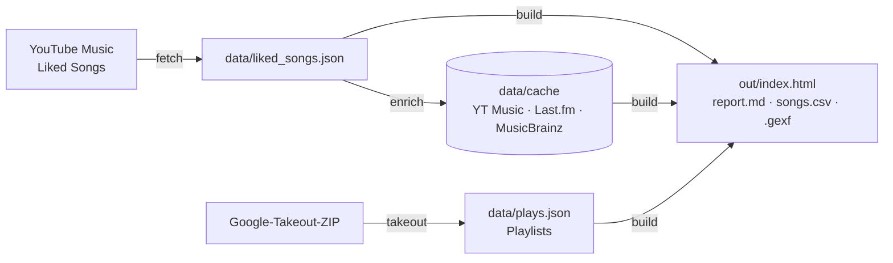

<div align="center">

# YT Music Liked Songs – Auswertungs-Dashboard

**Macht aus deinen „Mag ich“-Songs in YouTube Music ein interaktives Dashboard: deine Musik-DNA, Geschmack im
Wandel der Zeit, Hörgewohnheiten, ein Künstler-Netzwerk und Empfehlungen aus deiner eigenen Sammlung.**

[](https://github.com/cheatoskar/ytmusic-analyse/actions/workflows/tests.yml)
[](LICENSE)


[English](README.md) · **Deutsch**


</div>

> Die Screenshots zeigen die eingebauten Demo-Daten. In zwei Minuten selbst ausprobieren, ganz ohne Konto: siehe [Schnellstart](#schnellstart).

## Inhalt

- [Funktionen](#funktionen)
- [Schnellstart](#schnellstart)
- [Mit deinen eigenen Likes](#mit-deinen-eigenen-likes)
- [So funktioniert es](#so-funktioniert-es)
- [Datenschutz](#datenschutz)
- [Probleme lösen](#probleme-lösen)
- [Grenzen](#grenzen)
- [Aufbau](#aufbau)
- [Mitmachen](#mitmachen)

## Funktionen

| Seite | Was du bekommst |
|---|---|
| **Start** | Deine Musik-DNA auf einen Blick: Stil-Mix, Kennzahlen und automatisch erkannte Auffälligkeiten – Elektronik-Anteil, Vielfalt, Entdecker oder Fan, Underground-Anteil, wann du hörst, dein Dauerbrenner |
| **Geschmack** | Stile, Top-Künstler, Musik-Welten (Cluster), Stil-Mix je Playlist, Tags, Mainstream oder Underground, Herkunft, Kollaborationen, Feature-Könige |
| **Zeitreise** | Erscheinungsjahre, Geschmacksentwicklung, Stil × Jahrzehnt, wie frisch du hörst, neue Künstler über die Zeit, Songlängen |
| **Hören** *(mit Google Takeout)* | Hör-Kalender, Wochenverlauf, Wochentag × Uhrzeit mit Detail je Zeitfenster, Stil nach Tageszeit, Sessions, On Repeat, Künstler des Monats, vergessene Lieblinge, „oft gehört, nie geliked“ |
| **Entdecken** | Empfehlungen aus deinem eigenen Netzwerk (Künstler, die mit mehreren deiner Künstler verwandt sind, dir aber noch fehlen), Brücken-Künstler, zweite Chance, Hidden Gems, Zufallsfund |
| **Netzwerk- & Bubble-Map** | Jeder Künstler ein Knoten, verbunden über Features, verwandte Künstler und ähnliche Tags; Musik-Welten automatisch erkannt (Louvain); zoombare Bubbles Stil → Künstler → Song |
| **Künstler & Songs** | Durchsuch- und sortierbare Tabellen, CSV-Export der aktuellen Auswahl |

**Alles ist verknüpft.** Ein globaler Filter (Stil, Welt, Playlist, Jahre, Künstler, Land) wirkt auf jede Seite und
Karte. Jeder Balken und jeder Name ist anklickbar, jeder Künstler hat ein Profil (Songs, Like-Verlauf, Wiedergaben pro
Woche, Verbindungen, ähnliche Künstler), und <kbd>Strg</kbd>+<kbd>K</kbd> durchsucht alles. Filter und Profile stehen in
der Adresse und lassen sich als Lesezeichen speichern. Auf **Deutsch und Englisch**, hell und dunkel, vom großen
Monitor bis zum Handy.

<table>
  <tr>
    <td></td>
    <td></td>
  </tr>
  <tr>
    <td></td>
    <td></td>
  </tr>
</table>

## Schnellstart

**Voraussetzungen:** [Python 3.10+](https://www.python.org/downloads/) (unter Windows beim Installieren
*Add python.exe to PATH* anhaken) und [Git](https://git-scm.com/downloads) – oder das Repo über
**Code → Download ZIP** herunterladen.

**1. Einmalig einrichten**

<details open>
<summary>Windows (PowerShell)</summary>

```powershell
git clone https://github.com/cheatoskar/ytmusic-analyse.git
cd ytmusic-analyse
python -m venv .venv
.venv\Scripts\python -m pip install -r requirements.txt
```
</details>

<details>
<summary>macOS / Linux</summary>

```bash
git clone https://github.com/cheatoskar/ytmusic-analyse.git
cd ytmusic-analyse
python3 -m venv .venv
.venv/bin/python -m pip install -r requirements.txt
```
</details>

**2. Demo ausprobieren** – erzeugt erfundene Daten und öffnet das Dashboard im Browser:

```powershell
.venv\Scripts\python ytm.py demo        # macOS/Linux: .venv/bin/python ytm.py demo
```

**3. Mit deinen eigenen Likes** – die Kurzfassung (Details im nächsten Abschnitt):

```powershell
copy browser.example.json browser.json   # YouTube-Music-Cookie eintragen (Schritt 2 unten)
copy .env.example .env                   # optional: kostenlosen Last.fm-Key eintragen (Schritt 4 unten)
.venv\Scripts\python ytm.py fetch        # Liked Songs abrufen
.venv\Scripts\python ytm.py enrich       # Jahre, Stile, Herkunft, verwandte Künstler (dauert, jederzeit unterbrechbar)
.venv\Scripts\python ytm.py build        # Dashboard bauen
.venv\Scripts\python ytm.py open         # öffnen
```

Unter macOS/Linux `cp` statt `copy` und `.venv/bin/python` statt `.venv\Scripts\python`.

Das fertige Dashboard ist **`out/index.html`** – später einfach doppelklicken. (`web/index.html` ist nur die Vorlage
ohne Daten.) Nach neuen Likes `fetch`, `enrich` und `build` erneut ausführen; schon nachgeschlagene Künstler kommen
aus dem Cache.

## Mit deinen eigenen Likes

In den Befehlen unten steht `python` für `.venv\Scripts\python` (Windows) bzw. `.venv/bin/python` (macOS/Linux).

### 1. Google Takeout jetzt anfordern (optional, dauert Stunden bis 1 Tag)

1. <https://takeout.google.com> öffnen → **Auswahl aufheben**
2. Nur **YouTube und YouTube Music** anhaken
3. **Mehrere Formate** → bei **Verlauf** auf **JSON** stellen (Standard HTML funktioniert nicht)
4. **Alle YouTube-Daten enthalten** → nur **Verlauf**, **Playlists** und **music (library and uploads)**
   (Videos weglassen, die können riesig sein)
5. Einmalig exportieren, als .zip

### 2. Bei YouTube Music anmelden (`browser.json` anlegen)

Die Datei enthält dein Login-Cookie. Sie bleibt auf deinem Rechner und steht in `.gitignore` –
**niemals teilen oder committen.**

1. Vorlage kopieren: `browser.example.json` → `browser.json`
2. <https://music.youtube.com> in Chrome/Edge/Firefox öffnen und eingeloggt sein
3. **F12** → Reiter **Netzwerk** → Seite neu laden
4. Eine Anfrage wie `browse?…`, `account_menu?…` oder `guide?…` (Methode POST) anklicken
5. Unter **Request Headers** Rechtsklick auf `cookie` → **Wert kopieren**
6. In `browser.json` `PASTE_YOUR_COOKIE_HERE` durch diesen Wert ersetzen – eine Zeile, zwischen den Anführungszeichen

Alternative: `ytmusicapi browser` ausführen (wird mit den Requirements installiert) und alle Request-Header einfügen.
Dich in diesem Browser nicht bei YouTube abmelden, sonst wird das Cookie ungültig.

### 3. Liked Songs abrufen

```bash
python ytm.py fetch
```

### 4. Last.fm-API-Key (optional, empfohlen)

Ohne Key kommen Stile nur von MusicBrainz, und viele Künstler bleiben „Unbekannt“.
Key anlegen unter <https://www.last.fm/api/account/create> (Name und Beschreibung frei wählbar,
Callback und Homepage leer lassen; der Key erscheint sofort und ist für private Nutzung kostenlos).
`.env.example` nach `.env` kopieren und `LASTFM_API_KEY=dein_key` eintragen.

### 5. Anreichern

```bash
python ytm.py enrich
```

| Quelle | Liefert | Kosten |
|---|---|---|
| YouTube Music (dein Cookie) | Erscheinungsjahre, Abonnenten, verwandte Künstler (→ Empfehlungen) | kostenlos |
| Last.fm | Stil-Tags | kostenlos, braucht einen API-Key |
| MusicBrainz | Herkunftsland, Ersatz-Tags | kostenlos, ohne Key |

Dauer: etwa 1 s pro Album und Künstler (YT Music), 0,25 s pro Künstler (Last.fm) und 1,1 s pro Künstler
(MusicBrainz erlaubt eine Anfrage pro Sekunde). Bei ~3 000 Künstlern 1–2 Stunden. Abbrechen mit
<kbd>Strg</kbd>+<kbd>C</kbd> ist unproblematisch – der nächste Lauf macht dort weiter. Schneller geht es, wenn die
Dienste parallel in drei Terminals laufen:

```bash
python ytm.py enrich --no-lastfm --no-mb
python ytm.py enrich --no-albums --no-artists --no-mb
python ytm.py enrich --no-albums --no-artists --no-lastfm
```

### 6. Takeout einlesen (sobald die ZIP da ist)

```bash
python ytm.py takeout "Pfad/zu/takeout-XXXX.zip"
```

Die ZIP wird direkt gelesen, entpacken ist nicht nötig.

### 7. Bauen und öffnen

```bash
python ytm.py build
python ytm.py open
```

| Datei in `out/` | Inhalt |
|---|---|
| `index.html` | das interaktive Dashboard |
| `report.md` | alle Kennzahlen als Text |
| `songs.csv` | alle Songs mit Metadaten (öffnet direkt in Excel) |
| `kuenstler_netzwerk.gexf` | Künstler-Graph für [Gephi](https://gephi.org) |

**Direktlinks:** `out/index.html#home`, `#taste`, `#time`, `#listen`, `#discover`, `#network`, `#bubbles`,
`#artists`, `#songs` sowie `?lang=de` / `?lang=en`. Filter und Profile stehen ebenfalls in der Adresse,
z. B. `#taste?g=Trance&y0=2010&y1=2019`.

**Sprache und Zeitzone:** Die Seite folgt der Browsersprache (Umschalter in der Seitenleiste). Kommandozeile und
`report.md` folgen der Systemsprache – umstellbar mit `YTM_LANG=de|en`. Die Hör-Heatmap nutzt die Systemzeitzone –
umstellbar z. B. mit `YTM_TZ=Europe/Berlin`.

## So funktioniert es



- **Python** holt und ergänzt die Daten (ytmusicapi, requests), berechnet die Kennzahlen, baut den Künstler-Graphen
  und findet Musik-Welten per Louvain-Community-Erkennung (networkx).
- **Das Dashboard** ist eine statische Seite mit reinem JavaScript und [D3](https://d3js.org) – kein Server, kein
  Build-Schritt, kein Framework. Filter und Auswertungen laufen im Browser auf den eingebetteten Daten.

## Datenschutz

- Alles läuft auf deinem Rechner. Deine Daten werden nirgends hochgeladen.
- Die Skripte sprechen nur mit YouTube Music (dein Konto), MusicBrainz und optional Last.fm (nur Künstlernamen).
- Das Dashboard lädt D3 von cdnjs und Cover-Bilder von den Bildservern von YouTube.
- `browser.json`, `.env`, `data/` und `out/` stehen in `.gitignore`. Wenn du das Repo forkst, lass das so.

## Probleme lösen

| Problem | Lösung |
|---|---|
| Die Seite ist leer | `out/index.html` öffnen, nicht `web/index.html`. Vorher `python ytm.py build` ausführen. D3 braucht beim ersten Laden Internet. |
| `fetch` schlägt fehl oder meldet 401/403 | Cookie abgelaufen oder unvollständig kopiert – neu kopieren (Schritt 2) und in diesem Browser eingeloggt bleiben. |
| `fetch` bricht nach einem YouTube-Update | `python -m pip install -U ytmusicapi` |
| Viele Stile sind „Unbekannt“ | Last.fm-Key eintragen (Schritt 4) und `enrich` erneut ausführen. |
| „Hören“ ist leer | Google-Takeout-Export mit Verlauf als **JSON** einlesen (Schritte 1 und 6). |
| Die Seite wirkt nach dem Neubauen veraltet | Mit <kbd>Strg</kbd>+<kbd>F5</kbd> neu laden. |

## Grenzen

- **ytmusicapi ist inoffiziell.** Ändert YouTube intern etwas, kann der Abruf brechen. Die Anmeldung per Cookie ist in
  ytmusicapi als „deprecated“ markiert, funktioniert aber mit Version 1.12.
- YouTube Music meldet teils mehr Liked Songs, als es liefert (gelöschte/gesperrte Titel), und führt manche Songs
  doppelt; Duplikate werden entfernt, die Lücke wird angezeigt.
- **Like-Datum** gibt es nur, wenn dein Takeout die Liked-Liste mit Zeitstempeln enthält (oft nicht). Sonst zeigt die
  Geschmacksentwicklung die Like-Reihenfolge.
- **Wiedergaben** reichen nur so weit zurück, wie dein YouTube-Verlauf gespeichert wird. YT Music spielt manchmal eine
  andere Version (Video statt Audio) mit eigener ID ab; „nie gespielt“ ist daher eine Obergrenze.
- **Stile** gehören zum Hauptkünstler, nicht zum einzelnen Song. Bei Uploads wird der Künstler aus „Künstler - Titel“
  gelesen.
- BPM/Energie/Tanzbarkeit gibt es nicht (Spotify hat diese Schnittstelle für neue Apps geschlossen).

## Aufbau

```
ytm.py             Kommandozeile: fetch, enrich, takeout, build, open, demo
ytmlib/fetch.py    Abruf über ytmusicapi
ytmlib/enrich.py   Alben, Künstler, Last.fm, MusicBrainz (Cache in data/cache/)
ytmlib/takeout.py  Google-Takeout-Parser
ytmlib/build.py    Kennzahlen, Netzwerk + Louvain-Cluster, Empfehlungen, Ausgabe
ytmlib/genres.py   Tags → Stile
ytmlib/demo.py     erfundene Demo-Daten
web/               Dashboard (wird von build nach out/ kopiert)
  core.js          Datenaufbereitung, globaler Filter, Adresse
  charts.js        D3-Diagramme
  pages.js         Start, Geschmack, Zeitreise, Hören, Entdecken, Tabellen
  maps.js          Netzwerk- und Bubble-Map
  app.js           Navigation, Künstlerprofil, Suche
  i18n.js          deutsche und englische Texte
tests/             Takeout-Parser- und Build-Test (laufen in GitHub Actions)
```

## Mitmachen

Issues und Pull Requests sind willkommen. Vor einem PR:

```bash
python tests/test_takeout.py
python tests/test_build.py      # baut die Demo und prüft die Daten
```

Bei Änderungen an der Oberfläche das Ergebnis mit `python ytm.py demo` hell und dunkel und in beiden Sprachen prüfen.
`browser.json`, `.env`, `data/` und `out/` nie committen.

## Haftungsausschluss

Kein Bezug zu Google, YouTube, Last.fm oder MusicBrainz. Für die private Nutzung mit dem eigenen Konto.
Beachte die Nutzungsbedingungen der abgefragten Dienste.

## Lizenz

[MIT](LICENSE)
