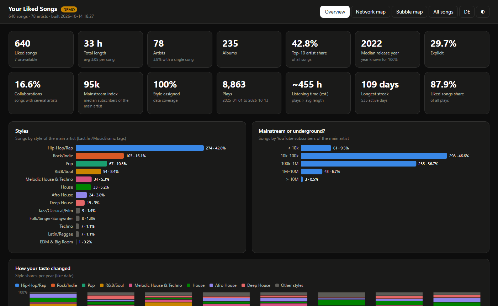
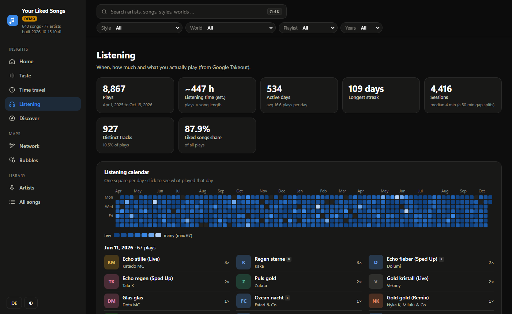
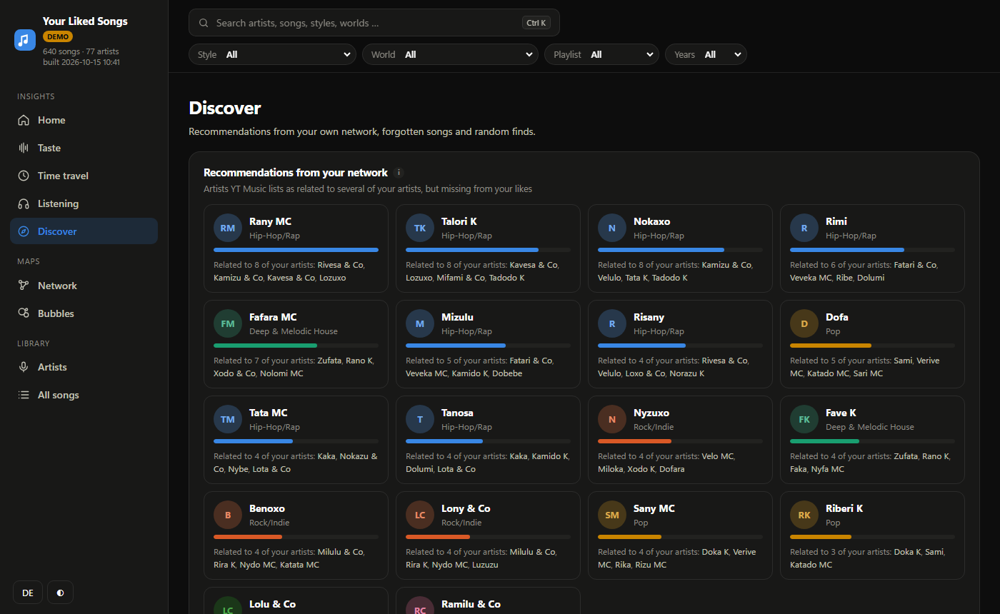
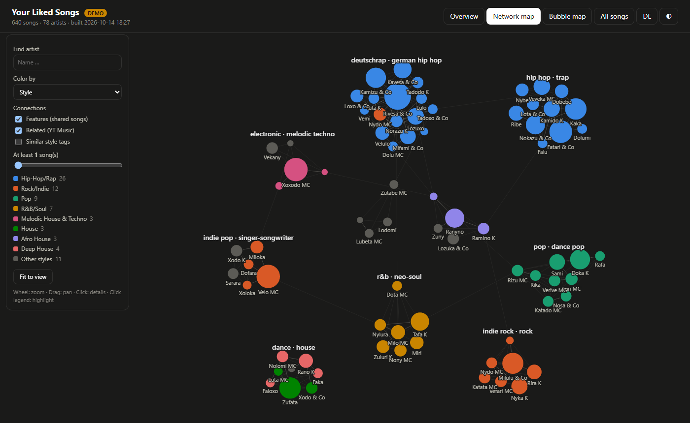
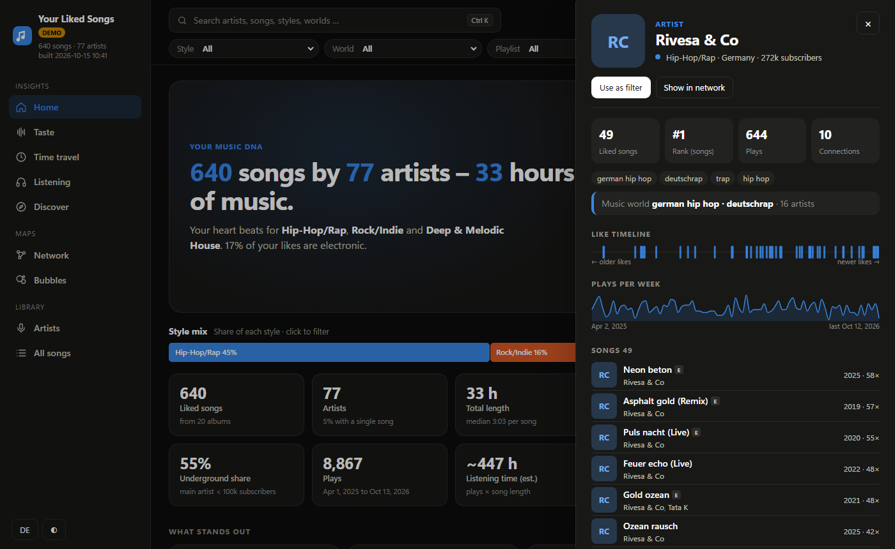
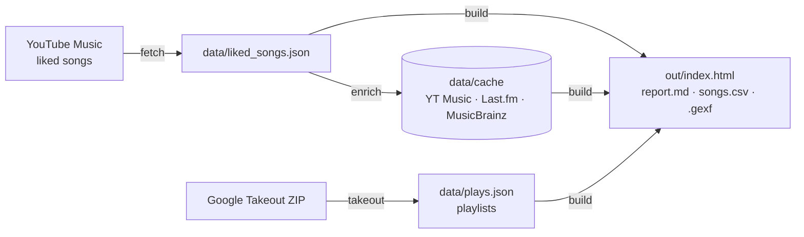

<div align="center">

# YT Music Liked Songs – Analysis Dashboard

**Turn your YouTube Music likes into an interactive dashboard: your music DNA, taste over time,
listening habits, an artist network and recommendations from your own library.**

[](https://github.com/cheatoskar/ytmusic-analyse/actions/workflows/tests.yml)
[](LICENSE)


**English** · [Deutsch](README.de.md)



</div>

> Screenshots use the built-in demo data. Try it yourself in two minutes without an account: see [Quick start](#quick-start).

## Contents

- [Features](#features)
- [Quick start](#quick-start)
- [Using your own likes](#using-your-own-likes)
- [How it works](#how-it-works)
- [Privacy](#privacy)
- [Troubleshooting](#troubleshooting)
- [Limitations](#limitations)
- [Project layout](#project-layout)
- [Contributing](#contributing)

## Features

| Page | What you get |
|---|---|
| **Home** | Your music DNA at a glance: style mix, key numbers and automatically detected highlights – electronic share, diversity, explorer or fan, underground share, when you listen, your all-time favourite |
| **Taste** | Styles, top artists, music worlds (clusters), style mix per playlist, tags, mainstream vs. underground, artist origin, collaborations, feature kings |
| **Time travel** | Release years, how your taste changed, style × decade, how fresh you listen, new artists over time, song lengths |
| **Listening** *(with Google Takeout)* | Listening calendar, weekly trend, weekday × hour with details per slot, style by time of day, sessions, on repeat, artist of the month, forgotten favourites, “played a lot, never liked” |
| **Discover** | Recommendations from your own network (artists related to several of yours that you don’t have yet), bridge artists, second chance, hidden gems, random find |
| **Network & bubble map** | Every artist as a node linked by features, related artists and similar tags; music worlds found automatically (Louvain); zoomable style → artist → song bubbles |
| **Artists & songs** | Searchable, sortable tables with CSV export of the current selection |

**Everything is linked.** One global filter (style, world, playlist, years, artist, country) applies to every page and map.
Every bar and name is clickable, every artist has a profile (songs, like timeline, plays per week, connections,
similar artists), and <kbd>Ctrl</kbd>+<kbd>K</kbd> searches everything. Filters and profiles live in the URL, so views
can be bookmarked. Available in **English and German**, light and dark mode, desktop to phone.

<table>
  <tr>
    <td></td>
    <td></td>
  </tr>
  <tr>
    <td></td>
    <td></td>
  </tr>
</table>

## Quick start

**Requirements:** [Python 3.10+](https://www.python.org/downloads/) (on Windows tick *Add python.exe to PATH*)
and [Git](https://git-scm.com/downloads) – or download this repo via **Code → Download ZIP**.

**1. Set up once**

<details open>
<summary>Windows (PowerShell)</summary>

```powershell
git clone https://github.com/cheatoskar/ytmusic-analyse.git
cd ytmusic-analyse
python -m venv .venv
.venv\Scripts\python -m pip install -r requirements.txt
```
</details>

<details>
<summary>macOS / Linux</summary>

```bash
git clone https://github.com/cheatoskar/ytmusic-analyse.git
cd ytmusic-analyse
python3 -m venv .venv
.venv/bin/python -m pip install -r requirements.txt
```
</details>

**2. Try the demo** – generates made-up data and opens the dashboard in your browser:

```bash
.venv/bin/python ytm.py demo        # Windows: .venv\Scripts\python ytm.py demo
```

**3. Use your own likes** – the short version (details in the next section):

```bash
cp browser.example.json browser.json   # paste your YouTube Music cookie (step 2 below)
cp .env.example .env                   # optional: add a free Last.fm key (step 4 below)
.venv/bin/python ytm.py fetch          # fetch liked songs
.venv/bin/python ytm.py enrich         # years, styles, origin, related artists (takes a while, safe to interrupt)
.venv/bin/python ytm.py build          # build the dashboard
.venv/bin/python ytm.py open           # open it
```

On Windows use `copy` instead of `cp` and `.venv\Scripts\python` instead of `.venv/bin/python`.

The finished dashboard is **`out/index.html`** – later just double-click it. (`web/index.html` is only the template
without data.) After new likes, run `fetch`, `enrich` and `build` again; artists already looked up come from the cache.

## Using your own likes

In the commands below, `python` means `.venv\Scripts\python` (Windows) or `.venv/bin/python` (macOS/Linux).

### 1. Request Google Takeout now (optional, takes hours to a day)

1. Open <https://takeout.google.com> → **Deselect all**
2. Tick only **YouTube and YouTube Music**
3. **Multiple formats** → set **History** to **JSON** (the default HTML does not work)
4. **All YouTube data included** → keep only **history**, **playlists** and **music (library and uploads)**
   (leave out *videos*, they can be huge)
5. Export once, as .zip

### 2. Log in to YouTube Music (create `browser.json`)

The file holds your login cookie. It stays on your machine and is listed in `.gitignore` –
**never share or commit it.**

1. Copy the template: `browser.example.json` → `browser.json`
2. Open <https://music.youtube.com> in Chrome/Edge/Firefox while logged in
3. Press **F12** → **Network** tab → reload the page
4. Click a request such as `browse?…`, `account_menu?…` or `guide?…` (method POST)
5. In **Request headers**, right-click `cookie` → **Copy value**
6. In `browser.json`, replace `PASTE_YOUR_COOKIE_HERE` with that value – one line, between the quotes

Alternative: run `ytmusicapi browser` (installed with the requirements) and paste all request headers.
Do not log out of YouTube in that browser, otherwise the cookie becomes invalid.

### 3. Fetch your liked songs

```bash
python ytm.py fetch
```

### 4. Last.fm API key (optional, recommended)

Without it, styles come from MusicBrainz only and many artists stay “Unknown”.
Create a key at <https://www.last.fm/api/account/create> (name and description are free text,
callback and homepage can stay empty; the key is shown immediately and is free for personal use).
Copy `.env.example` to `.env` and fill in `LASTFM_API_KEY=your_key`.

### 5. Enrich

```bash
python ytm.py enrich
```

| Source | Adds | Cost |
|---|---|---|
| YouTube Music (your cookie) | release years, subscribers, related artists (→ recommendations) | free |
| Last.fm | style tags | free, needs an API key |
| MusicBrainz | country of origin, fallback tags | free, no key |

Runtime: roughly 1 s per album and artist (YT Music), 0.25 s per artist (Last.fm) and 1.1 s per artist
(MusicBrainz allows one request per second). For ~3,000 artists expect 1–2 hours. Interrupting with
<kbd>Ctrl</kbd>+<kbd>C</kbd> is safe – the next run continues where it stopped. To speed it up, run the
services in parallel in three terminals:

```bash
python ytm.py enrich --no-lastfm --no-mb
python ytm.py enrich --no-albums --no-artists --no-mb
python ytm.py enrich --no-albums --no-artists --no-lastfm
```

### 6. Import Takeout (when the ZIP has arrived)

```bash
python ytm.py takeout "path/to/takeout-XXXX.zip"
```

The ZIP is read directly – no need to unpack it.

### 7. Build and open

```bash
python ytm.py build
python ytm.py open
```

| File in `out/` | Content |
|---|---|
| `index.html` | the interactive dashboard |
| `report.md` | all key numbers as text |
| `songs.csv` | all songs with metadata (opens in Excel) |
| `kuenstler_netzwerk.gexf` | artist graph for [Gephi](https://gephi.org) |

**Deep links:** `out/index.html#home`, `#taste`, `#time`, `#listen`, `#discover`, `#network`, `#bubbles`,
`#artists`, `#songs`, plus `?lang=en` / `?lang=de`. Filters and profiles are part of the address too,
e.g. `#taste?g=Trance&y0=2010&y1=2019`.

**Language and time zone:** the page follows your browser language (switch in the sidebar). The command line and
`report.md` follow the system language – override with `YTM_LANG=en|de`. The listening heatmap uses the system
time zone – override with e.g. `YTM_TZ=Europe/Berlin`.

## How it works



- **Python** fetches and enriches the data (ytmusicapi, requests), computes statistics, builds the artist graph
  and finds music worlds with Louvain community detection (networkx).
- **The dashboard** is a static page with plain JavaScript and [D3](https://d3js.org) – no server, no build step,
  no framework. All filtering and analysis runs in the browser on the embedded data.

## Privacy

- Everything runs on your machine. Your data is never uploaded anywhere.
- The scripts only talk to YouTube Music (your account), MusicBrainz and – optionally – Last.fm (artist names only).
- The dashboard loads D3 from cdnjs and cover images from YouTube’s image servers.
- `browser.json`, `.env`, `data/` and `out/` are in `.gitignore`. If you fork this repo, keep it that way.

## Troubleshooting

| Problem | Fix |
|---|---|
| The page is empty | Open `out/index.html`, not `web/index.html`. Run `python ytm.py build` first. D3 needs an internet connection on first load. |
| `fetch` fails or returns 401/403 | The cookie expired or was copied incompletely – copy it again (step 2) and stay logged in in that browser. |
| `fetch` breaks after a YouTube update | `python -m pip install -U ytmusicapi` |
| Many styles are “Unknown” | Add a Last.fm key (step 4) and run `enrich` again. |
| “Listening” is empty | Import a Google Takeout export with history as **JSON** (steps 1 and 6). |
| The page looks outdated after a rebuild | Hard-reload with <kbd>Ctrl</kbd>+<kbd>F5</kbd>. |

## Limitations

- **ytmusicapi is unofficial.** If YouTube changes its internals, fetching can break. Cookie-based login is marked as
  deprecated in ytmusicapi but works as of version 1.12.
- YouTube Music sometimes reports more liked songs than it returns (deleted/blocked tracks) and lists some songs twice;
  duplicates are removed and the gap is shown.
- **Like dates** are only available if your Takeout contains the liked list with timestamps (often it does not).
  Otherwise “how your taste changed” uses the like order.
- **Plays** only cover the period your YouTube history keeps. YT Music sometimes plays a different version
  (video instead of audio) with its own ID, so “never played” is an upper bound.
- **Styles** belong to the main artist, not to the individual song. For uploads, the artist is read from
  “Artist - Title”.
- BPM/energy/danceability are not available (Spotify closed that API for new apps).

## Project layout

```
ytm.py             command line: fetch, enrich, takeout, build, open, demo
ytmlib/fetch.py    fetching via ytmusicapi
ytmlib/enrich.py   albums, artists, Last.fm, MusicBrainz (cached in data/cache/)
ytmlib/takeout.py  Google Takeout parser
ytmlib/build.py    statistics, network + Louvain clusters, recommendations, output
ytmlib/genres.py   tags → styles
ytmlib/demo.py     made-up demo data
web/               dashboard (copied to out/ by build)
  core.js          data preparation, global filter, URL state
  charts.js        D3 chart components
  pages.js         home, taste, time travel, listening, discover, tables
  maps.js          network and bubble map
  app.js           navigation, artist profile, search
  i18n.js          English and German texts
tests/             Takeout parser and build tests (run in GitHub Actions)
```

## Contributing

Issues and pull requests are welcome. Before opening a PR:

```bash
python tests/test_takeout.py
python tests/test_build.py      # builds the demo and checks the data
```

For UI changes, check the result with `python ytm.py demo` in light and dark mode and in both languages.
Never commit `browser.json`, `.env`, `data/` or `out/`.

## Disclaimer

Not affiliated with Google, YouTube, Last.fm or MusicBrainz. For personal use with your own account.
Respect the terms of the services you query.

## License

[MIT](LICENSE)
